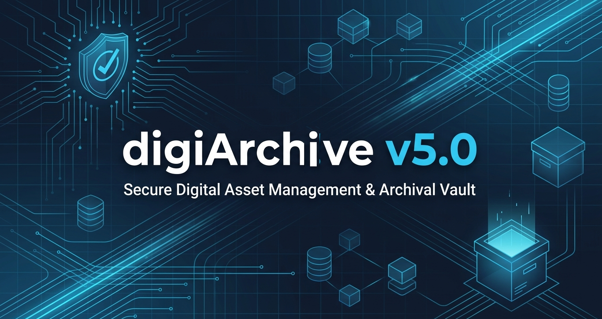
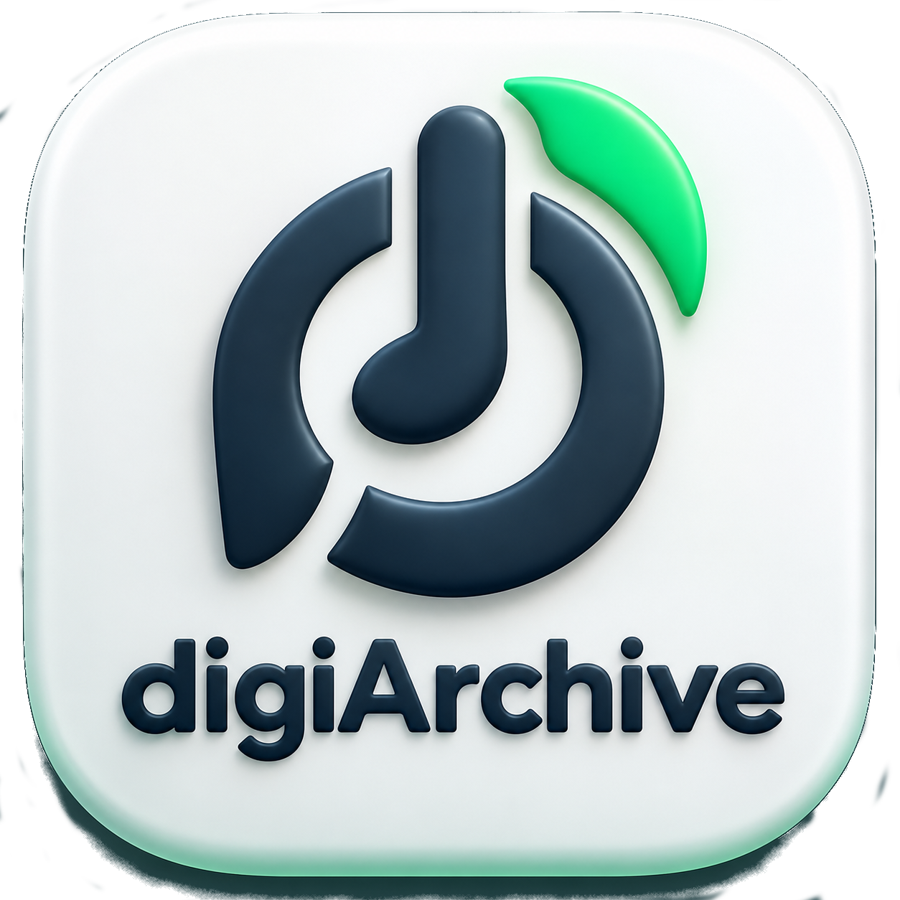

<!--suppress CheckImageSize -->
<div style="text-align: center;">
  <!-- Main Banner -->
   
  <br/><br/>
  <!-- Flexbox Row Container (Guaranteed Center Aligned) -->
  <div style="display: flex; justify-content: center; align-items: center; gap: 20px; flex-wrap: wrap; margin: 20px 0;">
    <div>  </div>
    <div style="text-align: left;">
      <strong style="font-size: 22px;">digiArchive — Digital Archive & Metadata Manager (v5.0.1)</strong>
    </div>
  </div>
  <br/>


<!-- Badges -->
[](https://github.com/kr-hari-ps/Project-DigitalArchive/releases)
[](#-system-requirements)
[](LICENSE)
[](https://www.qt.io/)
[-red.svg)](#-system-requirements)

<h3>⚡ Device-Independent Digital Archive, Ingestion Engine & Metadata Manager</h3>
  <p></p>

**[System Requirements](#-system-requirements)** |
**[Software Requirements](#-software-requirements)** |
**[Video Explainer](#-video-explainer)** |
**[Installation](#-quick-start--installation)** |
**[Architecture](#-core-architecture--operational-pipeline)** |
**[Documents](#-documentation--reference)**
  <br/>
</div>


---

#### 📖 Overview
**digiArchive** is a robust, privacy-first desktop application designed for long-term digital asset preservation, cross-device ingestion, and metadata integrity. It enforces strict separation between **physical source occurrences** (what exists on an attached tablet, phone, or disk) and **logical master assets** (deduplicated files indexed by SHA-256 fixity).

All operations follow non-destructive, transaction-safe protocols: source media is never modified during ingestion or hygiene scans, and administrative operations are gated by two-factor authentication (2FA) backed by the embedded `vault_security` database schema.

---

#### 💻 System Requirements
To run digiArchive and authenticate administrative vault operations, ensure your environment meets the following hardware and software specifications:

##### 🖥️ Hardware Requirements
| Requirement                        | Minimum Specification                                                                                | Recommended Specification                      |
|:-----------------------------------|:-----------------------------------------------------------------------------------------------------|:-----------------------------------------------|
| **Host Workstation**               | 64-bit x86_64 CPU (2.0 GHz dual-core)                                                                | Multi-core x86_64 CPU (Intel Core / AMD Ryzen) |
| **System Memory (RAM)**            | 2 GB RAM                                                                                             | 4 GB+ RAM                                      |
| **Host Storage**                   | 200 MB for binary; Archive vault size dependent on user media volume                                 | Fast NVMe / SSD for vault staging & database   |
| **Mobile Device (Phone / Tablet)** | **Required**: Smartphone or tablet running Android or iOS with a working camera or manual text entry | Any modern iOS or Android device               |
| **Connection Hardware**            | USB 2.0 port and standard data sync cable for attached source devices                                | USB 3.0+ port / high-speed USB-C data cable    |

>📱 **Why a Phone is Required:**
>digiArchive enforces offline Two-Factor Authentication (2FA) via RFC 6238 Time-Based One-Time Passwords (TOTP). Secrets are stored securely in the `vault_security` table inside `catalog.db`. During setup, a Base32 key links with an authenticator app on your mobile phone to generate 6-digit codes unlocking sensitive administrative actions (such as database restoration or catalog rollbacks).

---

##### 📦 Software Requirements
| Category                      | Component                | Description                                                                                                                                                                                                                                            |
|:------------------------------|:-------------------------|:-------------------------------------------------------------------------------------------------------------------------------------------------------------------------------------------------------------------------------------------------------|
| **Host Operating System**     | Linux x86_64             | Ubuntu 22.04 LTS+, Debian 12+, Fedora 38+, or compatible modern Linux distribution                                                                                                                                                                     |
| **Display Server**            | X11 or Wayland           | Graphical desktop environment capable of running Qt6 applications                                                                                                                                                                                      |
| **Mobile Authenticator App**  | **RFC 6238 TOTP App**    | Any standard authenticator app installed on your smartphone: <br>• **Aegis Authenticator** (Open Source / Recommended) <br>• **2FAS** (Open Source) <br>• **Google Authenticator** <br>• **Microsoft Authenticator** <br>• **Bitwarden Authenticator** |
| **Multimedia (Video Splash)** | `gstreamer1.0 runtime`   | Required for Welcome video playback (`sudo apt install libgstreamer1.0-0 gstreamer1.0-plugins-good gstreamer1.0-libav`)                                                                                                                                |
| **Device Probing (Optional)** | `android-tools-adb`      | Recommended for automated Android USB detection and on-device hash extraction (`sudo apt install android-tools-adb`)                                                                                                                                   |

---

#### 🎥 Video Explainer

A complete video explainer for device onboarding, media ingestion, duplicate resolution, and GFS snapshot restoration is available:

Watch the demo on YouTube visit: [youtube.com/@encloudme](https://www.youtube.com/@encloudme) 
Or click below link to watch:

[](https://www.youtube.com/watch?v=pt0YgawliFM)  
---

#### 🚀 Quick Start & Installation

digiArchive is distributed as a standalone Linux binary compiled via Nuitka. It requires no Python interpreter or virtual environment to run.

##### Quick repository tree requirements
```text
Project-digiArchive/                      # REPO_ROOT
├── assets/
│   └── icons/
│       └── digiArchive.png               # Mandatory: Application icon (ICON_NAME)
├── database/
│   └── schema.sql                        # Mandatory: Authoritative SQLite DDL (v3.1 schema)
├── installers/
│   ├── install-digiarchive.sh            # Installer script (executable: chmod +x)
│   ├── uninstall-digiarchive.sh          # Uninstaller script
│   └── requirements.txt                  # Optional: Fallback requirements location
├── releases/
│   └── digiArchive-linux-x86_64.bin      # Mandatory: Standalone binary, available in releases section (executable)
├── config/                               # Optional: Receives mirrored .desktop copy
│   └── digital-archive.desktop
└── requirements.txt                      # Optional: Primary requirements location
```
_Note: requirements installation is applicable only for raw src code execution, ignore for BINARY installations_

##### Essential files & permission check list
| Path                                    | Purpose                                               | Permissions    |
|-----------------------------------------|-------------------------------------------------------|----------------|
| `installers/install-digiarchive.sh`     | Main installation routine                             | chmod +x (755) |
| `installers/uninstall-digiarchive.sh`   | App removal routine                                   | chmod +x (755) |
| `releases/digiArchive-linux-x86_64.bin` | Target executable deployed to `/usr/local/bin`        | chmod +x (755) |
| `assets/icons/digiArchive.png`          | Source image deployed to `/usr/share/icons` & pixmaps | read (644)     |
| `requirements.txt`                      | Dependency checklist for PySide6 / CLI tools          | read (644)     |

---

##### 1. Automated Installation
Clone the repository and run the setup script:

```bash
git clone https://github.com/encloudme/digiArchive.git Project-digiArchive
cd Project-digiArchive
```

```bash
# Execute the installation script (installs to /usr/local/bin or ~/.local/bin)
chmod +x installers/install-digiarchive.sh
bash installers/install-digiarchive.sh
```

The installer verifies prerequisites, installs desktop menu shortcuts, configures application icons, and creates the default vault directory at `$HOME/digiArchive_Vault`.

##### 2. Launching digiArchive
Launch digiArchive either from your desktop application launcher or via terminal:

```bash
digiArchive
```

*(Alternatively, run the standalone binary directly: `./releases/digiArchive-linux-x86_64.bin`)*


##### 3. Uninstallation
To cleanly remove the application while safely preserving your vault data and catalog database:
```bash
chmod +x installers/uninstall-digiarchive.sh
bash installers/uninstall-digiarchive.sh
```

---

#### 🏛️ Core Architecture & Operational Pipeline
digiArchive decouples physical source occurrences from logical deduplicated assets:

```text
[ Attached Source Device (e.g. Phone / Tablet) ]
                      │
                      ▼
             1. Two-Pass Scanner (Pass 1: Metadata -> Pass 2: SHA-256)
                      │
                      ▼
     2. Delta Classification (NEW, DUPLICATE_EXACT, CHANGED)
                      │
        ┌─────────────┴─────────────┐
        ▼                           ▼
  [ NEW_LOGICAL_FILE ]         [ DUPLICATE_EXACT ]
  • Physical Transfer Staging  • Bypass physical transfer
  • Pre/Post SHA-256 Fixity    • Register in asset_inventory
  • Promote to Master Vault    • Map occurrence in asset_map
  • Register in files table    • Update copy_manifest
```
* **Physical Occurrence (`asset_inventory`)**: Authoritative log of files observed across connected devices and source paths.
* **Logical File (`files`)**: Authoritative record for unique master assets, keyed strictly by SHA-256 hash.
* **Bridge (`asset_map`)**: Connects multiple physical occurrences to a single logical master record.
* **Vault Security (`vault_security`)**: Embedded table storing `db_uuid`, `admin_hash`, Base32 `totp_secret`, and `vault_name`.

---

#### 🔐 Administrative Security & TOTP 2FA
Sensitive catalog maintenance (such as rolling back the SQLite catalog from a hot-backup or replacing active databases) is shielded by a two-factor authentication gate:
1. **Admin Master Password**: Validated against `admin_hash` stored in `vault_security`.
2. **Offline TOTP Token**: 6-digit token generated on your mobile phone via an RFC 6238 authenticator app.
3. **Drift-Tolerant Validation**: Supports +-30-second epoch intervals to accommodate clock differences between workstation and mobile phone.

---

#### 📚 Documentation & Reference
* 📖 **[Detailed User Guide](documents/USER_GUIDE.md)**: Full end-to-end operational handbook covering all tabs and workflows.
* 📋 **[Release Notes](RELEASE_NOTES_v5.0.1.md)**: Feature breakdown, changelog, and migration notes for v5.0.1.
* 🗒️ **[Change Log](CHANGELOG.md)**: Detailed version history.
* 📜 **[Software License](LICENSE)**: Open-source MIT License terms.

---

#### 📄 License
This project is licensed under the terms of the **MIT License**. See [LICENSE](LICENSE) for details.